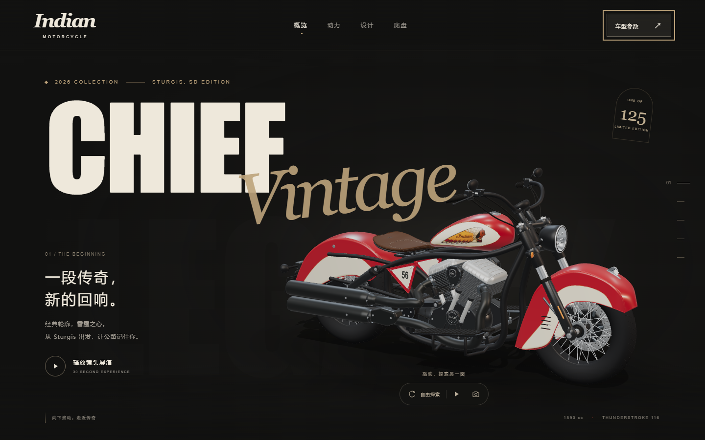

# Chief Vintage — 交互式 3D 宣传页面

基于项目内完成的 2026 Indian Chief Vintage Sturgis, SD Edition 模型制作。页面使用真实 3D 网格，包含滚动镜头、30 秒自动展演、自由旋转与缩放、视角截图，以及四类车型参数。



仓库包含网页源码、约 3.9 MB 的 GLB 模型、内嵌纹理、本地 Draco 解码器与页面图片。克隆后可独立运行，无需安装 Blender。

新增 [中文 3D 宣传片工程](video/README.md)：48 秒、1080p、六组动态镜头，包含可编辑参数字幕、中文合成旁白和原创氛围音乐。视频工程位于 `video/`，独立运行，不影响网页。

```powershell
git clone https://github.com/zhengdegu/Indian_Chief_Vintage_2026.git
cd Indian_Chief_Vintage_2026
npm ci
npm run dev
```

## 打开页面

Windows 双击 **`start-preview.cmd`**。脚本会寻找已安装的 Node.js，在需要时安装依赖，启动仅本机可访问的服务，并在服务就绪后打开浏览器。

本机地址：<http://127.0.0.1:4173>

首次启动需要联网安装 npm 依赖；依赖装好后，模型、贴图、Draco 解码器和网页资源均从本机加载。保持启动窗口运行，按 `Ctrl+C` 可停止服务。如本项目已在该端口运行，脚本直接打开已有页面。

也可在本目录手动执行：

```powershell
npm install
npm run dev -- --strictPort
```

需要 Node.js **20.19+ 或 22.12+**；推荐当前 Node.js LTS。使用便携版 Node.js 时，请将其目录加入 `PATH`。

## 使用方式

- **滚动或章节导航**：在整车、动力、工艺、底盘、特别版五个镜头之间切换。
- **播放镜头展演**：自动完成 30 秒展演，可暂停、继续或退出；手动滚动会退出展演。
- **自由探索**：拖动旋转，滚轮或双指缩放；再次点击“返回叙事”恢复滚动镜头。桌面上直接拖动模型也会进入自由探索。
- **自动环绕**：在自由探索中缓慢旋转镜头，按钮可暂停。
- **相机按钮**：下载当前 3D 视角 PNG，不包含页面文字与界面。
- **车型参数**：打开参数面板；左右箭头、Home、End 可切换分类，Esc 可关闭面板。
- **细节卡片**：查看油箱徽标与皮革座椅渲染近景。

页面适配手机和桌面，并响应系统“减少动态效果”偏好。设备不能加载 WebGL 时会显示静态渲染图，仍可浏览车型故事和参数。3D 展示需要支持 WebGL 2 的现代浏览器。

## 构建

```powershell
npm run build
npm run preview -- --strictPort
```

构建结果位于 `dist/`。`preview` 仅用于本地预览。本项目当前按网站根路径 `/` 配置；部署到子目录前，需要同步调整 Vite 的 `base` 与模型、解码器和图片的资源路径。

## 文件

| 路径 | 用途 |
|---|---|
| `src/main.js` | 页面结构、章节、展演、参数与模态框交互 |
| `src/scene.js` | Three.js 场景、镜头、光照、模型加载与截图 |
| `src/style.css` | 桌面、手机与减少动态效果样式 |
| `src/content.js` | 车型参数及资料来源 |
| `public/models/chief-vintage.glb` | 约 3.9 MB 的压缩网页模型 |
| `public/draco/` | 本地 Draco 解码器 |
| `public/images/` | 本项目 Blender 渲染图的 WebP 版本 |
| `ASSET_NOTES.md` | 图片、纹理与参数出处 |
| `docs/` | 模型说明、检查记录与最终预览 |
| `THIRD_PARTY_NOTICES.md` | 第三方组件来源与许可证 |

已完成桌面、手机视口、展演、参数面板、PNG 下载与静态回退检查，记录见 [验证说明](docs/VALIDATION.md)。[查看手机预览](docs/preview-mobile.png)。

原始可编辑 Blender 工程保留在制作工作区，本仓库包含供浏览器使用的优化导出模型。模型数据与导出边界见 [模型说明](docs/MODEL.md)。

## 车型依据

1890 cc、156 N·m、1626 mm 轴距与 686 mm 座高来自 Chief Vintage 官方车型资料；限量 125 台、双色涂装、56 号图形与 Espresso 独座依据特别版公告。参数面板附有原始资料链接与适用说明。

- [Indian Motorcycle 特别版公告](https://www.indianmotorcycle.co.uk/news/detail/indian-chief-vintage-sturgis/)
- [Indian Motorcycle Chief Vintage](https://www.indianmotorcycle.co.uk/chief-vintage/)
- [Cycle News 特别版资料](https://www.cyclenews.com/2026/08/article/2026-indian-chief-vintage-sturgis-sd-edition-specs-and-price/)

这是非官方车型概念展示。模型依据公开照片与尺寸进行外观重建，部分隐藏结构和曲面为照片推定，不是厂商制造 CAD；页面图片为模型渲染。完整资产来源说明见 `ASSET_NOTES.md`。
